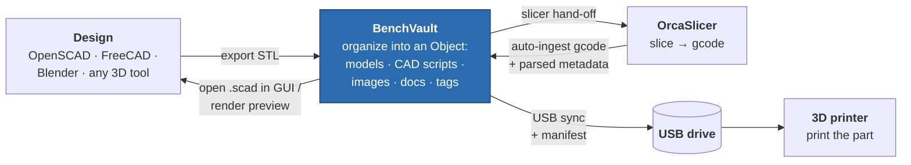

Mirrored on GitHub — development happens on Codeberg: https://codeberg.org/manzari/BenchVault

# BenchVault

A cross-platform (Linux-first) desktop app for organizing 3D-printing projects. Each **Object** groups the STL parts, OpenSCAD sources, sliced gcodes, images, and notes that belong to one thing you print — with slicer metadata parsed automatically and everything searchable.

BenchVault owns a managed library on disk (human-readable folder layout), so your files stay plain files you can browse, back up, or take with you.

## Workflow

BenchVault sits at the centre of a print project — from CAD source to a printed part — keeping every artifact filed against the Object it belongs to.



1. **Design** a part in OpenSCAD (or FreeCAD, Blender, …) and export an STL — or import one from a URL like Thingiverse.
2. **Organize** it in BenchVault: models (STL/OBJ/STEP/3MF), CAD scripts (`.scad`, CadQuery `.py`), images, markdown docs and notes all live under one Object. Open `.scad` files back in the OpenSCAD GUI or render previews in-app.
3. **Slice** by handing an asset straight to OrcaSlicer; the resulting gcode is auto-ingested with its slicer metadata parsed.
4. **Sync** the gcodes to a mounted USB drive with a manifest.
5. **Print** — feed the USB stick to the printer.

## Features

- **Library organization** — nested folders, objects with cover images, tags, manual sort order, breadcrumb navigation.
- **3D preview** — interactive three.js viewer for STL and OBJ; snapshot any angle as the object's cover image.
- **Model geometry** — triangle/vertex counts, bounding-box size, volume, surface area, and watertightness computed on import for STL, OBJ, and 3MF; 3MF also carries its declared units, document metadata, and an embedded thumbnail that auto-fills the object cover.
- **Docs & CAD scripts** — keep markdown notes (rendered as GitHub-flavored markdown) and CadQuery/OpenSCAD scripts filed alongside the part.
- **Gcode metadata** — slicer, profile, print time, filament usage parsed on import. Supports the PrusaSlicer family (PrusaSlicer, SuperSlicer, OrcaSlicer, BambuStudio) and Cura.
- **OpenSCAD support** — open `.scad` sources in the OpenSCAD GUI, render previews via the OpenSCAD CLI (cached on disk), and see extracted customizer parameters, dependencies, and module/function names in the CAD Scripts list.
- **Slicer hand-off** — open assets directly in OrcaSlicer.
- **Import from URL** — paste a Thingiverse link to create an object with title, author, license, and cover image; with an API token the model files are downloaded too.
- **USB sync** — detect mounted drives and sync gcodes to them with a manifest, for printers fed by USB stick.
- **Auto-ingest** — a background watcher picks up files dropped into the library directory and files them automatically.
- **Full-text search** — SQLite FTS5 across the library.

## Supported formats

Everything you import is stored as a plain file in the managed library. The table shows what BenchVault does *beyond* storing it — parse metadata, preview in 3D, render, or hand off to the slicer.

| Format | Stored |  Metadata   |    Preview    | Render |  Hand-off  |
|---|:------:|:-----------:|:-------------:|:---:|:----------:|
| **STL** (`.stl`) |   ✅   | ✅ geometry |      ✅       | — | ✅ to orca |
| **OBJ** (`.obj`) |   ✅   | ✅ geometry |      ✅       | — |     —      |
| **3MF** (`.3mf`) |   ✅   |     ✅      |       —       | — |     —      |
| **G-code** (`.gcode`, `.gco`, `.g`) |   ✅   |     ✅      |       —       | — |     —      |
| G-code binary (`.bgcode`) |   ✅   |      —      |       —       | — |     —      |
| **OpenSCAD** (`.scad`) |   ✅   |  ✅ static  | ✅ via render | ✅ |     —      |
| **CadQuery** (`.py`) |   ✅   |      —      |       —       | — |     —      |
| **Markdown** (`.md`, `.markdown`) |   ✅   |      —      |   ✅ via render    | ✅ |     —      |
| CAD / STEP (`.step`, `.stp`, `.iges`, `.igs`, `.f3d`, `.sldprt`) |   ✅   |      —      |       —       | — |     —      |
| Images (`.png`, `.jpg`, `.jpeg`, `.webp`, `.gif`, `.bmp`, `.svg`) |   ✅   |      —      |       —       | — |     —      |
| Anything else (`.pdf`, `.txt`, `.zip`, …) |   ✅   |      —      |       —       | — |     —      |

Models (STL/OBJ/STEP/3MF) share one **Models** section; STL and OBJ render directly in the in-app 3D viewer, while STEP and 3MF are stored and listed (3MF still gets its geometry and metadata parsed on import). OpenSCAD and CadQuery scripts share a **CAD Scripts** section (OpenSCAD sources also render to a previewable mesh, and their parameters/dependencies are listed). Markdown files render as formatted notes in a **Docs / Notes** section. Images double as object cover art (snapshot the 3D viewer, set any imported image, or let a 3MF's embedded thumbnail fill in). STL parts are the only assets sent to OrcaSlicer.
## Stack

- **Tauri 2** — Rust backend + system webview
- **React 18** + TypeScript + Vite + Mantine 7 + TanStack Router + Zustand
- **SQLite** via `sqlx` with versioned migrations and FTS5 search
- **three.js** via `@react-three/fiber` for STL/OpenSCAD previews
- **specta + tauri-specta** — TypeScript bindings generated from the Rust command signatures, so the IPC contract can't drift

## Install

Build from source (see below) and install the resulting bundle, or on Debian/Ubuntu let the Makefile do both:

```sh
make install-host   # builds the .deb and installs it via apt
```

## Prerequisites (building from source)

Install once on Linux:

```sh
# Rust
curl --proto '=https' --tlsv1.2 -sSf https://sh.rustup.rs | sh

# Node (via your favourite manager — fnm shown here)
curl -fsSL https://fnm.vercel.app/install | bash
fnm install 20

# Tauri system deps (Debian/Ubuntu)
sudo apt update
sudo apt install -y libwebkit2gtk-4.1-dev build-essential curl wget file \
  libxdo-dev libssl-dev libayatana-appindicator3-dev librsvg2-dev
```

Optional integrations: [OpenSCAD](https://openscad.org/) for `.scad` previews, [OrcaSlicer](https://github.com/SoftFever/OrcaSlicer) for slicer hand-off. Both are auto-detected; paths can be overridden in Settings.

## Develop

```sh
npm install        # or pnpm / bun
npm run tauri dev  # Vite + Rust with hot reload on both sides
```

The first launch creates `<app_data>/library/` and `benchvault.db`, and runs all migrations.

`make help` lists the other targets (`check`, `clippy`, `test`, `bindings`, …).

## Build

```sh
npm run tauri build
```

Produces `.deb` / `.rpm` / `.AppImage` on Linux. Windows/macOS targets build but aren't tested or gated by CI yet.

## Architecture

The Rust backend follows a strict `commands → service → repository → db` layering; the frontend talks to it through generated typed bindings.

- `src-tauri/src/commands/` — thin Tauri command handlers
- `src-tauri/src/service/` — business logic (file ingestion, imports, USB sync, external tools)
- `src-tauri/src/repository/` — all SQL, one module per table family
- `src-tauri/src/parsers/` — pure gcode/STL parsers
- `src-tauri/migrations/` — versioned SQL, run automatically on start
- `src/` — React frontend
- `src/lib/bindings.ts` — generated by specta (`make bindings`) — do not hand-edit

The schema is intentionally polymorphic (`assets`, `tags` + `entity_tags`, `entity_links`, one FTS5 index keyed by entity kind), so future entity types — printers, filaments, print jobs, slicer profiles, costs — drop in without re-architecting. See `CLAUDE.md` for the full contributor guide.
